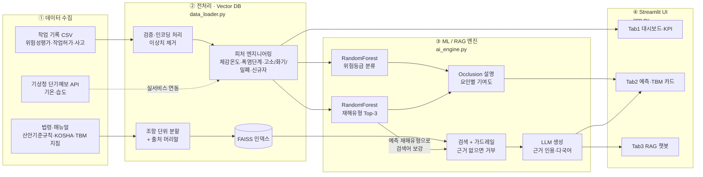

# 🛠️ SafeYard Copilot
### 부울경 조선소 외국인 근로자 맞춤 · "근거 있는" 다국어 TBM 생성기

> **한 줄 요약**: 오늘의 작업 조건을 넣으면 ML이 재해 위험과 유형을 예측하고,
> RAG가 산업안전보건기준규칙·안전 매뉴얼에서 근거 조항을 찾아 **근로자 모국어로 된 작업 전 안전점검(TBM) 카드**를 만들어 줍니다.

---

## 1. 프로젝트 상세 기획서

### 1-1. 문제 정의
| 구분 | 내용 |
|---|---|
| 지역 | 거제·통영·울산 동구·부산 영도 등 부울경 조선소 밀집 지역 |
| 현상 | 조선업 신규 인력의 대다수가 외국인으로 채워지고, 사고 상당수가 목격자 없이 발생 |
| 페인포인트 | ① TBM이 한국어 구두 설명 위주 → 이해 여부 확인 불가<br>② 번역기는 "말"만 옮기고 "왜 위험한지, 어떤 규정인지" 근거를 주지 못함<br>③ 폭염 + 밀폐 + 신규자처럼 **위험 조건이 겹치는 날**을 사전에 짚어 주는 도구 부재 |
| 사용자 | 작업반장·안전관리자(주 사용자), 외국인 근로자(챗봇 질의) |

### 1-2. 시스템 아키텍처



**핵심 설계 포인트: ML → RAG 연결.**
예측된 재해유형(예: 질식)과 작업 조건 플래그(밀폐·화기·고소·폭염)를 RAG 검색어에 자동으로 보강합니다(`build_tbm_query`).
그래서 근로자가 질문하지 않아도 **"오늘 이 작업에 해당하는 조항"이 먼저 검색**됩니다.

### 1-3. 폴더 구조
```
safeyard-copilot/
├── app.py                  # Streamlit UI (사이드바 + 3개 탭)
├── ai_engine.py            # ML 학습/예측/설명 + RAG 벡터스토어/검색/생성
├── data_loader.py          # 데이터 로딩·검증·피처 엔지니어링·KPI·문서 분할
├── requirements.txt
├── .env.example            # API 키·임베딩 설정 템플릿
└── data/
    ├── work_records_sample.csv   # 합성 데이터 (최초 실행 시 자동 생성)
    └── docs/                     # RAG 문서 (md/txt/pdf) — 여기에 원문 추가
        ├── 01_산업안전보건기준규칙_발췌요약.md
        ├── 02_조선업_작업별_안전작업_가이드.md
        ├── 03_폭염_온열질환_예방_가이드.md
        └── 04_TBM_및_외국인근로자_안전소통_지침.md
```
`models/`, `vector_store/` 폴더는 실행 중 자동 생성됩니다.

### 1-4. WBS (4주)

| 주차 | 단계 | 세부 작업 | 산출물 | 완료 기준 |
|---|---|---|---|---|
| **1주** | 기획 · 데이터 | ① 문제 정의·페르소나 확정 (반장/외국인 근로자)<br>② 데이터 확보: KOSHA 재해사례, 국가법령정보센터 API, 기상청 API 키 발급<br>③ 합성 데이터로 파이프라인 먼저 구동 (`python data_loader.py`)<br>④ 실데이터 컬럼 매핑표 작성 (§1-6) | 기획서, 데이터 명세서, EDA 노트 | 샘플·실데이터 모두 `load_records()` 통과 |
| **2주** | 모델링 · RAG | ① 베이스라인(로지스틱 회귀) vs RandomForest 비교<br>② 고위험 Recall 기준 하이퍼파라미터 튜닝<br>③ 법령 **원문**으로 docs 교체, 청크 크기 실험(300/500/800)<br>④ 평가셋 20문항 구축 → Hit@k·근거 인용률 측정<br>⑤ 임베딩 hashing → bge-m3 전환 비교 | 학습된 모델, FAISS 인덱스, 성능표 | 고위험 Recall ≥ 0.8, Hit@4 ≥ 0.8 |
| **3주** | UI 개발 | ① 사이드바 입력 → Tab2 예측 연결<br>② Tab1 KPI·차트, Tab3 챗봇 대화 이력<br>③ TBM 카드 다운로드, 근거 펼침 UI<br>④ 반장 1~2명 대상 사용성 테스트 (가능하면) | 동작하는 프로토타입 | 3개 탭 오류 없이 시연 |
| **4주** | 통합 · 발표 | ① LLM 연결 후 다국어 품질 점검 (원어민 확인 권장)<br>② 예외 처리: API 키 없음 / 근거 없음 / 잘못된 CSV<br>③ Streamlit Community Cloud 배포<br>④ 시연 시나리오: "탱크 내부 용접 · 체감 34℃ · 경력 2개월 · 베트남어" | 배포 URL, 발표자료, 시연 영상 | 5분 시연 리허설 완료 |

### 1-5. 데이터 리터러시 인사이트 — 핵심 KPI 3가지

| KPI | 정의 | 왜 중요한가 | 해석 시 주의 |
|---|---|---|---|
| **① 폭염 상대위험도 (RR)** | P(사고 \| 체감 33℃↑) ÷ P(사고 \| 체감 31℃ 미만) | "여름에 사고가 많다"가 아니라 **같은 작업량 대비 몇 배 위험한지**를 보여 줌 → 휴식 주기 조정 근거 | 여름엔 작업량 자체가 많을 수 있음. 반드시 **작업 건수(분모)** 대비 비율로 봐야 함 |
| **② 신규자 사고 집중도** | (사고 중 경력 3개월 미만 비중) ÷ (전체 작업 중 3개월 미만 비중) | 1보다 크면 신규자가 자기 몫보다 사고를 더 많이 겪는다는 뜻 → 2인 1조·단독배치 금지 정책 근거 | 외국인 여부가 아니라 **언어 장벽·경력**이 원인 변수인지 분리해서 봐야 함 (차별적 해석 금지) |
| **③ 위험 집중도 (파레토)** | 사고 상위 20% '작업유형×시간대' 셀이 전체 사고에서 차지하는 비중 | 높을수록 **특정 구간만 집중 관리해도 효과가 큼** → TBM 강화 시간대 선정 | 셀당 건수가 적으면 우연 변동이 큼. 건수 기준치(예: 30건 이상) 설정 권장 |

**모델 품질 지표(보조)**
- **고위험 Recall**: 실제 "높음"을 놓치지 않은 비율입니다. 안전 도메인에서는 정확도보다 이 지표가 우선입니다.
- **근거 인용률 / Hit@k**: RAG 답변이 실제 근거 조항을 가져왔는지 측정합니다.

> 💡 **발표에서 꼭 짚을 데이터 리터러시 포인트**
> KOSHA 재해사례 같은 공개 데이터에는 **사고가 난 건만** 있습니다. 사고가 나지 않은 작업은 기록되지 않습니다.
> 그래서 "사고율"을 계산하려면 사내 작업허가·위험성평가 기록 같은 **분모(노출량) 데이터**가 반드시 필요합니다.
> 이 한계를 인지하고 합성 데이터로 구조를 먼저 검증했다는 점 자체가 좋은 평가 포인트가 됩니다.

### 1-6. 실데이터 교체 가이드

| 용도 | 출처 | 연결 방법 |
|---|---|---|
| 재해유형 라벨 | 안전보건공단 재해사례 / 공공데이터포털 '산업재해 현황' | 사고 개요 텍스트 → `hazard_type` 6종으로 키워드 매핑 |
| 위험등급 라벨 | 사내 위험성평가 기록 (상/중/하) | `risk_level` 컬럼에 그대로 입력 (텍스트 자동 변환 지원) |
| 기상 | 기상청 단기예보 API (거제·울산 동구 격자) | `temp_c`, `humidity` 실시간 주입 → 사이드바 기본값으로 사용 |
| 법령 원문 | 국가법령정보센터 Open API | 조문 텍스트를 `data/docs/*.txt`로 저장 (줄 머리 `제N조`에서 자동 분할) |
| 다국어 교육자료 | 안전보건공단 외국인 안전보건자료 (16개국 언어) | PDF를 사이드바에서 업로드 또는 docs 폴더에 추가 |

**CSV 스키마 (필수 7개 + 선택)**
```
work_type, height_m, confined_space(0/1), temp_c, humidity, hour, experience_months   ← 필수
language_barrier(0/1), subcontractor(0/1), language                                    ← 선택(기본값 채움)
risk_level(0/1/2 또는 상/중/하), hazard_type, incident(0/1)                              ← 학습·KPI용 라벨
```
- `work_type`은 `data_loader.WORK_TYPES`의 8종 중 하나여야 합니다.
- 인코딩은 utf-8과 cp949를 자동으로 판별합니다.

---

## 2. 소스코드 구조 요약

| 파일 | 주요 함수 | 설명 |
|---|---|---|
| `data_loader.py` | `generate_synthetic_records()` | 1년치 조선소 작업 기록 합성 (조건→위험 규칙 내장) |
| | `engineer_features()` | 기상청 체감온도 공식, 폭염 단계, 고소(2m↑)·화기·밀폐·신규자·야간 플래그 |
| | `load_records()` / `validate_records()` | 인코딩 자동 판별, 스키마 검증, 이상치 제거 |
| | `compute_kpis()` | KPI 3종 계산 |
| | `load_documents()` / `split_documents()` | md/txt/pdf 로딩 → **조항 경계 1차 분할 + 길이 2차 분할** |
| `ai_engine.py` | `train_models()` | OneHot+RandomForest 2종 학습, Recall·F1·Top-2 정확도 평가 |
| | `predict_risk()` / `explain_local()` | 위험지수(0~100), 재해유형 Top-3, 요인별 기여도 |
| | `HashingKoreanEmbeddings` | 설치 즉시 동작하는 오프라인 한국어 임베딩 |
| | `load_or_build_vector_store()` / `search()` | FAISS 구축·저장·재사용, 코사인 유사도 반환 |
| | `answer_question()` / `generate_tbm_card()` | 가드레일 → LLM 생성(근거 인용·다국어) 또는 추출형 폴백 |
| `app.py` | 사이드바 + Tab 1·2·3 | 캐시(`cache_data`/`cache_resource`), 세션 상태 기반 챗봇 |

**두 가지 실행 모드**
| | API 키 없음 (기본) | API 키 있음 |
|---|---|---|
| 챗봇 | 검색된 근거 조항을 출처와 함께 나열 | 근거 인용 요약 답변 + 모국어/한국어 병기 |
| TBM 카드 | 한국어 템플릿 카드 (근거 체크리스트 자동 추출) | 선택 언어로 된 4단 구성 카드 |

---

## 3. 설치 및 실행 가이드

### 3-1. 설치
```bash
# 1) 가상환경 (권장)
python -m venv .venv
source .venv/bin/activate          # Windows: .venv\Scripts\activate

# 2) 패키지 설치
pip install -r requirements.txt

# 3) (선택) LLM 연결
pip install langchain-anthropic     # 또는 langchain-openai
cp .env.example .env                # Windows: copy .env.example .env
#   → .env 에 ANTHROPIC_API_KEY=... 입력
```

### 3-2. 실행
```bash
# 엔진 단독 점검 (선택) — 학습 결과, 예측, TBM 카드를 터미널에 출력
python data_loader.py
python ai_engine.py

# 웹 앱 실행
streamlit run app.py
```
브라우저에서 `http://localhost:8501`이 열립니다. 최초 실행 시 합성 데이터 생성, 모델 학습, 인덱스 구축에 수 초가 걸립니다.

### 3-3. 시연 시나리오 (5분)
1. **Tab 1**: "체감 33℃↑ 구간 사고율이 3배" → 폭염 RR KPI 설명
2. **사이드바**: 탱크·이중저 내부 작업 / 밀폐 ON / 기온 31℃ / 경력 2개월 / 베트남어 선택
3. **Tab 2**: 위험지수 게이지 "높음", 질식 확률 80% → 요인 기여도에서 "밀폐공간·경력"이 원인임을 확인
4. **TBM 카드 생성** → 근거 조항(제619조의2 등) 펼쳐 보기
5. **Tab 3**: "동료가 탱크 안에서 쓰러졌어요" → 맨몸 진입 금지 수칙 근거 답변
6. What-if 마무리: 경력을 36개월로 올리면 위험지수가 약 89 → 72로 내려갑니다. "숙련자와 2인 1조 배치"가 데이터로 뒷받침되는 대책임을 보여 줍니다. (기온만 22℃로 내리면 89 → 84로 소폭 감소하므로, 폭염보다 밀폐·경력이 이 작업의 핵심 위험임을 함께 설명할 수 있습니다.)

### 3-4. 문제 해결
| 증상 | 해결 |
|---|---|
| `필수 컬럼 누락` | CSV 컬럼명을 §1-6 스키마에 맞추세요 |
| 챗봇이 "근거를 찾지 못했습니다"만 답함 | hashing 모드는 단어가 겹쳐야 검색됩니다. 문서 표현을 넣어 질문하거나 `EMBEDDING_BACKEND=huggingface`로 전환하세요 |
| 임베딩 백엔드를 바꾼 뒤 오류 | `vector_store/` 폴더를 삭제하면 자동으로 재생성됩니다 |
| 외국어 질문이 검색되지 않음 | hashing 모드의 한계입니다. bge-m3(다국어) 임베딩으로 전환하세요 |

---

## 4. 고도화 로드맵 (발표 Q&A 대비)
- **백엔드 분리**: 추론과 RAG를 FastAPI(`/predict`, `/tbm`, `/chat`)로 분리하고 Streamlit은 화면만 담당 → 사내 메신저 봇·모바일 앱에서 같은 API를 재사용
- **설명가능성**: Occlusion 방식을 SHAP TreeExplainer로 교체해 비교
- **하이브리드 검색**: BM25(키워드)와 벡터 검색을 결합하고 리랭커 추가
- **실시간 기상**: 기상청 API로 사이드바 기온·습도 자동 채움, 폭염특보 시 알림
- **현장 피드백 루프**: TBM 카드에 "이해했어요 / 모르겠어요" 버튼 → 이해도 데이터 축적

> ⚠️ `data/docs`의 문서는 학습용 요약본이고, 샘플 CSV는 합성 데이터입니다.
> 실제 현장에 적용하기 전에 반드시 원문 법령·사내 지침·실데이터로 교체하고 안전관리자의 검토를 받으세요.
